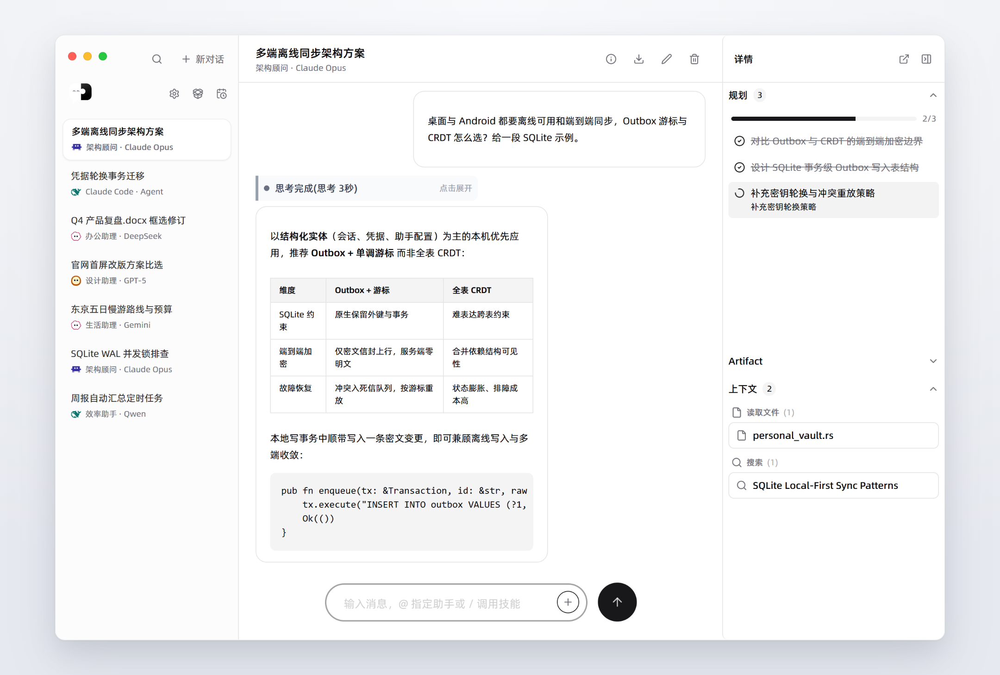
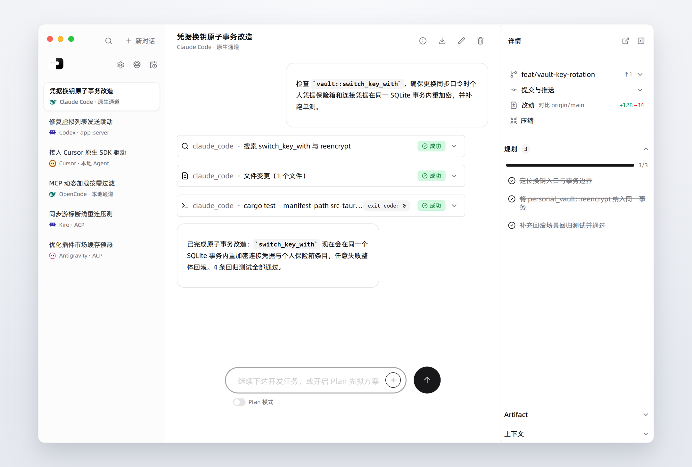
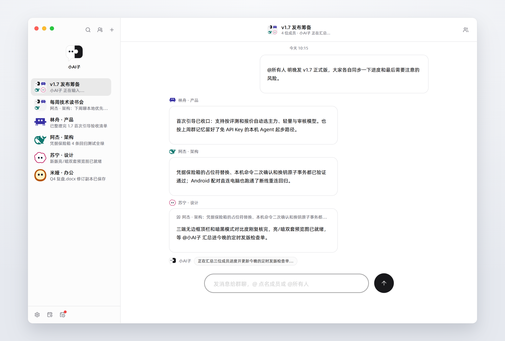
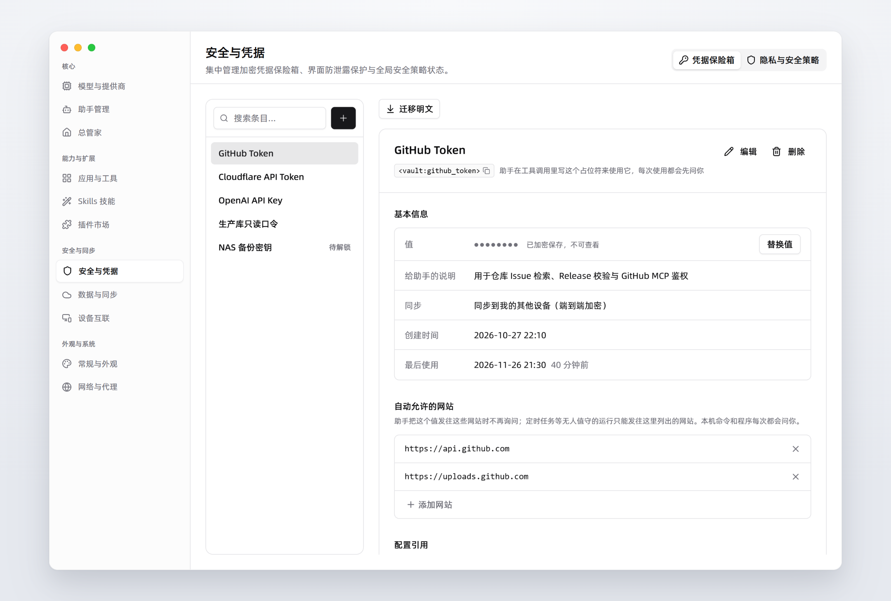
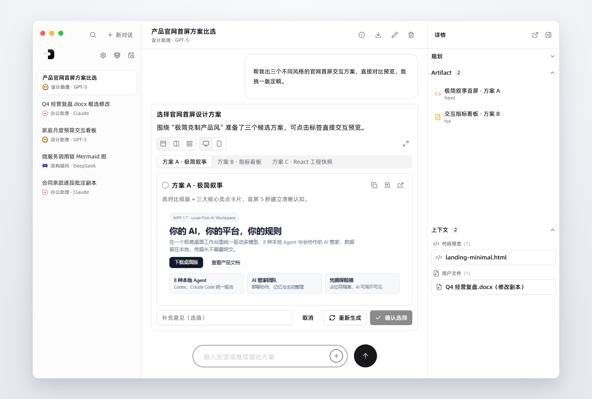
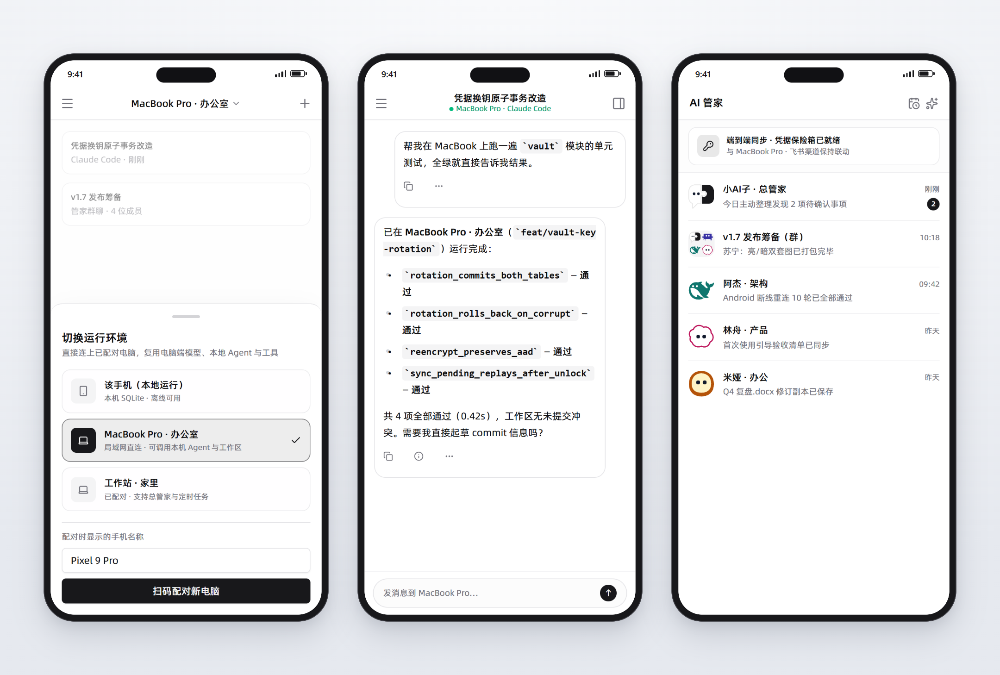

<div align="center">

<br/>


# AIPP

**你的 AI，你的平台，你的规则**

集多模型对话、本地 Agent、AI 管家团队与凭据保险箱于一体的本地优先跨平台 AI 工作台

<br/>

[](https://github.com/xieisabug/AIPP/releases/latest)
[](LICENSE)
[](https://github.com/xieisabug/AIPP/releases/latest)

<br/>

[**下载最新版**](https://github.com/xieisabug/AIPP/releases/latest) &nbsp;·&nbsp; [**产品文档**](docs/product/README.md) &nbsp;·&nbsp; [**架构总览**](docs/architecture.md) &nbsp;·&nbsp; [**English**](README_EN.md)

<br/>

<picture>
  <source media="(prefers-color-scheme: dark)" srcset="docs/readme/hero-dark.png" />
  <source media="(prefers-color-scheme: light)" srcset="docs/readme/hero-light.png" />
  
</picture>

</div>

<br/>

## 一个工作台，驾驭多模型与本地 Agent

不再在网页端、终端和多个客户端之间反复切换。把常用的云端模型与本机智能体收拢进同一套顺手的交互界面。

- **主流模型自由切换**：支持 OpenAI、Anthropic、DeepSeek、Gemini、Ollama、GitHub Copilot、OpenCode Go、Magpie 等来源；支持消息分支、重新生成、思考过程展示与对话上下文压缩（`/compact`）。
- **原生统一驱动本地 Agent**：内置 **Codex、Claude Code、Cursor、OpenCode、Pi、Kiro、Antigravity** 原生通道与 **ACP** 协议，在统一的时间线里查看检索、代码 Diff 与终端输出。
- **为真实研发工作流打磨**：内置 **Plan 模式**、原生权限档位控制、会话级 **Git 工作区**（分支切换、改动统计与一键起草提交），以及精确的 Token、缓存与订阅额度统计。

<picture>
  <source media="(prefers-color-scheme: dark)" srcset="docs/readme/agent-dark.png" />
  <source media="(prefers-color-scheme: light)" srcset="docs/readme/agent-light.png" />
  
</picture>

<br/>

## 会协作、有记忆、会主动干活的 AI 管家团队

每个助手都可以是你的长期联系人——既能一对一私聊交付，也能拉进同一个群聊分工讨论、互相接力。

- **私聊、群聊与跨助手接力**：在群里 `@成员` 或 `@所有人` 发起协作，不点名时由辅助模型自动路由发言人；支持多轮讨论、进度实时上报与跨助手委托。
- **分层长期记忆**：按「助手私有 / 群共享 / 全局」作用域自动沉淀偏好与共识，并在后续对话中按需增量回放，越用越懂你的上下文。
- **主动整理与定时任务**：自主 Agent 定时巡检未尽事项并生成可一键采纳的建议卡片；定时任务在后台无人值守运行，高风险操作经模型审核与总管家裁决，只在值得汇报时通知你。

<picture>
  <source media="(prefers-color-scheme: dark)" srcset="docs/readme/butler-dark.png" />
  <source media="(prefers-color-scheme: light)" srcset="docs/readme/butler-light.png" />
  
</picture>

<br/>

## 让 AI 使用凭据，却永远看不见明文

安全不该靠口头约束。AIPP 在本机存储与工具执行之间建立硬隔离，让敏感凭据真正可控、可审计。

- **个人凭据保险箱**：密钥由系统钥匙串加密保存；助手在工具参数中只填写 `<vault:键>` 占位符，由 Rust 执行层在发出请求前替换并自动遮盖响应中的真值——模型上下文、日志与历史库均不落明文。
- **逐次审批与去向白名单**：网页请求可按站点域名授权白名单，本机命令与文件调用每次必须人工确认；MCP 服务与模型提供商配置同样支持安全引用保险箱条目。
- **本地优先与端到端同步**：全部数据默认保存在本机 SQLite、零遥测；支持界面防泄露脱敏模式，以及可选自建端到端加密同步服务（[`sync-server/`](sync-server)）。

<picture>
  <source media="(prefers-color-scheme: dark)" srcset="docs/readme/vault-dark.png" />
  <source media="(prefers-color-scheme: light)" srcset="docs/readme/vault-light.png" />
  
</picture>

<br/>

## 所见即交付：方案比选、Artifacts 与 Office 协同

从想法到可运行产物，直接在对话内完成预览、对比、微调与安全交付。

- **会话内方案比选**：一次生成多个可交互页面或完整工程快照，标签切换对比、留反馈迭代，支持 Bun 临时沙箱构建与独立窗口预览。
- **Artifacts 与脚本执行**：即时渲染 HTML、React、Vue、Mermaid 与 Draw.io，并支持一键收藏与在可控环境中直接运行 Python / Shell 等脚本。
- **Office 文档无损协作**：内置预览支持框选多处段落汇总交给 AI 修改，输出结果始终另存为新副本，保护原文件不被意外改写。

<picture>
  <source media="(prefers-color-scheme: dark)" srcset="docs/readme/delivery-dark.png" />
  <source media="(prefers-color-scheme: light)" srcset="docs/readme/delivery-light.png" />
  
</picture>

<br/>

## 全端联通，随处调动本机能力

覆盖桌面三端与移动端，并把电脑上的本机算力与工具链安全延伸到口袋里。

- **三端一致的现代桌面体验**：Windows、macOS、Linux 统一无边框融合顶栏，支持 `Ctrl+Shift+I` 全局快速提问与系统托盘常驻。
- **Android 离线可用 + 配对直连电脑**：手机端既能独立运行，也可扫码配对局域网内的桌面设备，一键切换运行环境，在手机上直接调用电脑端的本地 Agent、工作区与管家会话。
- **飞书双向接入（实验）**：将总管家消息、主动整理简报与交互卡片延伸至飞书会话。

<picture>
  <source media="(prefers-color-scheme: dark)" srcset="docs/readme/everywhere-dark.png" />
  <source media="(prefers-color-scheme: light)" srcset="docs/readme/everywhere-light.png" />
  
</picture>

<br/>

## 生态与更多能力

- **应用目录与动态 MCP**：内置网页搜索抓取、文件读写、Shell 等常用工具，统一管理应用目录与 OAuth/本地 MCP 连接；工具按需动态加载，高风险操作先经模型审核。
- **GitHub 能力包**：一键安装来自 GitHub 的 Agent 能力包，自动配套其中的 Skills 与 MCP 连接，支持固定版本更新与一键回退。
- **插件市场与自定义形象**：支持主题、自定义渲染、Bang 快捷命令、生命周期 Hook、后台扩展与声明式助手形象/配饰包。
- **Skills 技能体系**：支持本地与官方技能库一键安装并按助手精细绑定，在输入框用 `/` 随时呼出。
- **顺手的日常细节**：`!` Bang 快捷指令、Markdown / PNG / PDF / DOCX 一键导出、跨会话搜索与细粒度 Token 用量面板。

<br/>

## 快速开始

前往 [GitHub Releases](https://github.com/xieisabug/AIPP/releases/latest) 下载对应平台的安装包：

| Windows | macOS | Linux | Android |
| :---: | :---: | :---: | :---: |
| `.msi` | `.dmg`（Apple Silicon / Intel） | `.AppImage` | `.apk`（arm64） |

1. **安装并打开 AIPP**：桌面端首次启动会自动进入**首次使用引导**。
2. **完成一键配置**：自动检测已安装的本机 Agent，或填写 API Key 后按评测与价格自动分配主力、轻量与审核模型。
3. **开始使用**：`Ctrl+Shift+O` 打开主工作台，`Ctrl+Shift+I` 随时呼出快速提问，侧栏随时开启 AI 管家与定时任务。

<br/>

<details>
<summary><strong>从源码构建、自建同步与技术栈</strong></summary>

<br/>

### 环境要求

Node.js 20.19+ / 22.12+、pnpm 10、Rust stable、`protoc`，以及 [Tauri 2 平台依赖](https://tauri.app/start/prerequisites/)。

```bash
git clone https://github.com/xieisabug/AIPP.git
cd AIPP
pnpm install

pnpm tauri dev                                   # 桌面开发模式
pnpm package                                     # 打包桌面安装包
pnpm test                                        # 运行前端测试
cargo test --manifest-path src-tauri/Cargo.toml  # 运行后端测试
```

- **依赖说明**：Cargo 会自动拉取固定提交的 `rust-genai` 依赖，无需手动克隆同级目录。
- **Android 开发**：需要 Android SDK / NDK 与 JDK 17，参见 [`scripts/android-dev.ps1`](scripts/android-dev.ps1)。
- **自建同步服务**：可选部署 [`sync-server/`](sync-server)（FastAPI + SQLite），服务端仅保存密文信封与同步游标，不接触解密密钥。
- **贡献指引**：参与开发前请先阅读 [AGENTS.md](AGENTS.md) 与 [架构总览](docs/architecture.md)。

| 层级 | 技术栈 |
| :--- | :--- |
| 桌面与后端 | Rust · Tauri 2 · SQLite（rusqlite）· Tokio |
| 前端与界面 | React 19 · TypeScript · Vite · shadcn/ui · Tailwind CSS v4 |
| AI 与协议 | genai fork · rmcp（MCP）· 原生 Agent 驱动（Codex / Claude Code / Cursor / OpenCode / Pi / Kiro / Antigravity / ACP） |
| 同步与检索 | FastAPI（[`sync-server/`](sync-server)）· chromiumoxide |

</details>

<br/>

## 文档

[产品功能总览](docs/product/README.md) · [首次使用引导](docs/product/23-首次使用引导.md) · [Agent 与 ACP 集成](docs/product/11-ACP集成.md) · [AI 管家系统](docs/product/18-Butler任务系统.md) · [凭据保险箱](docs/product/22-凭据保险箱.md) · [定时任务](docs/product/09-定时任务.md) · [应用与 MCP](docs/product/04-MCP工具系统.md) · [GitHub 能力包](docs/product/21-GitHub插件包.md) · [插件系统](docs/product/10-插件系统.md) · [制品预览与执行](docs/product/06-制品预览与执行.md) · [数据与同步](docs/product/15-数据存储.md)

---

<div align="center">

基于 [Apache 2.0](LICENSE) 开源 · Built with Rust, React & AI

</div>
