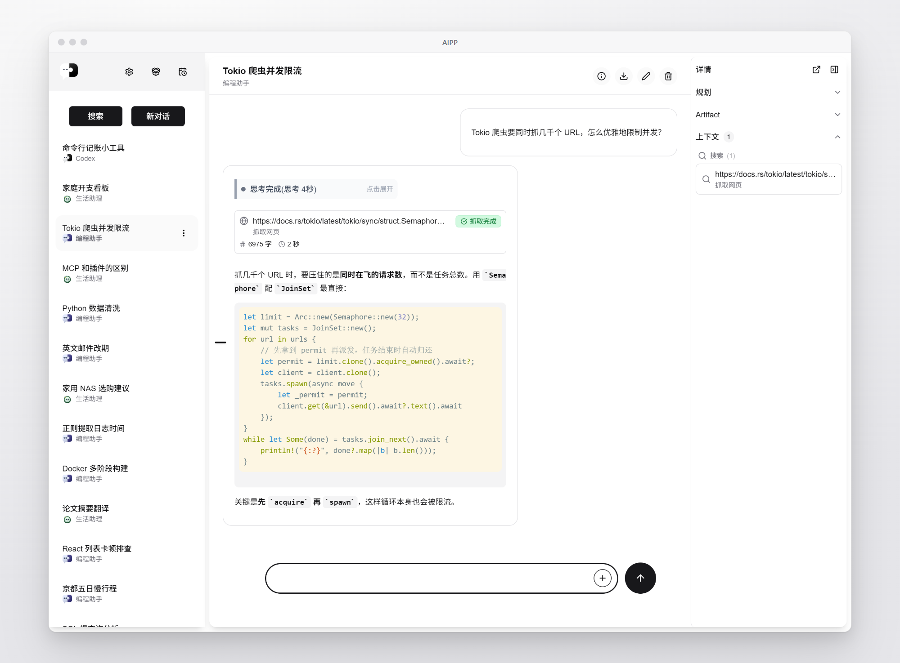
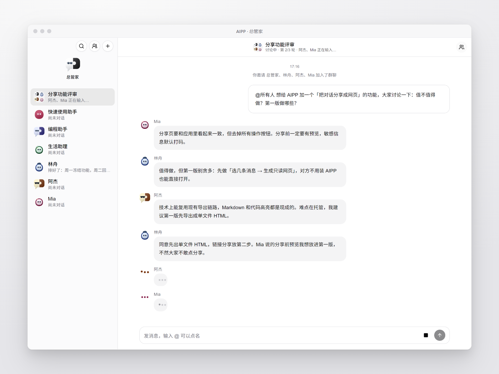
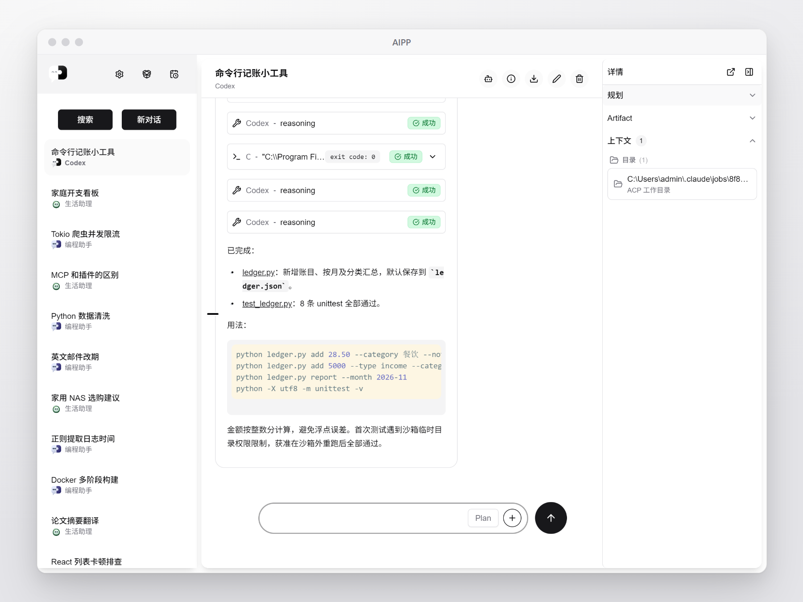
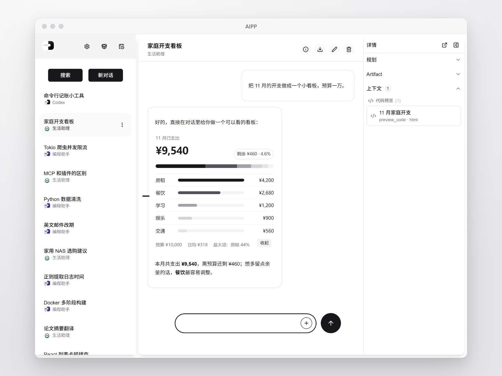
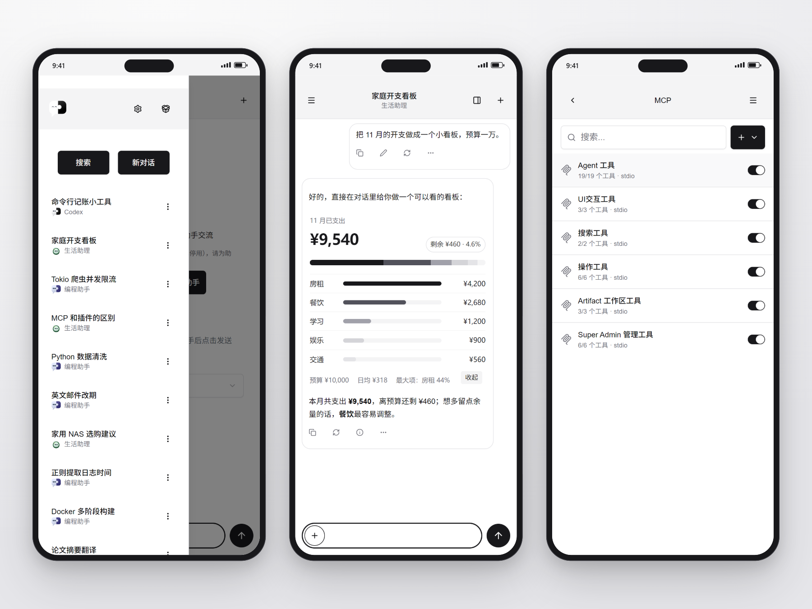

<div align="center">


# AIPP

### 你的 AI，你的平台，你的规则

多模型对话 · 本地 Agent · MCP 工具 · Artifacts · 会拉群的 AI 管家

[](https://github.com/xieisabug/AIPP/releases/latest)
[](LICENSE)
[](https://tauri.app/)
[](https://react.dev/)
[](https://www.rust-lang.org/)


[**⬇️ 下载**](https://github.com/xieisabug/AIPP/releases/latest) &nbsp;·&nbsp; [**🎉 1.5.0 更新**](https://github.com/xieisabug/AIPP/releases/tag/v1.5.0) &nbsp;·&nbsp; [**📚 文档**](docs/product/README.md)

<br/>



</div>

<br/>

## 🎉 1.5.0：把助手们拉个群

<table>
<tr>
<td width="56%">



</td>
<td valign="top">

**👥 管家群聊**<br/>
@ 谁谁回答，不 @ 自动挑人；能一起回复，也能多轮讨论

**🤝 助手互相协作**<br/>
转交、请教、接力，谁接手谁直接跟你说

**🤖 统一 Agent 驱动**<br/>
Codex / Claude Code / ACP 走同一个入口

**🌐 新模型来源**<br/>
OpenCode Go 订阅、Magpie 本机网关

**📱 Android APK**<br/>
Release 页直接下载

</td>
</tr>
</table>

<p align="right"><a href="https://github.com/xieisabug/AIPP/releases/tag/v1.5.0">完整更新日志 →</a></p>

## ✨ 能做什么

<table>
<tr>
<td width="33%" valign="top">

### 💬 多模型对话
OpenAI、Anthropic、DeepSeek、Ollama、Copilot、OpenCode Go、Magpie… 一个窗口随时切换，支持分支、重生成和思考过程展示。

</td>
<td width="33%" valign="top">

### 🧑‍💻 本地 Agent
Codex、Claude Code，以及 Gemini / Kimi 等 ACP Agent 直接在 AIPP 里跑；计划、提问、审批都有专门的卡片。

</td>
<td width="33%" valign="top">

### 🏠 AI 管家
所有助手都是联系人：私聊、派活、拉群讨论，还能接到飞书里用。

</td>
</tr>
<tr>
<td valign="top">

### 🔧 MCP 工具
工具按需动态加载，交给模型审核后再执行；内置搜索、网页抓取、文件读写和 Shell。

</td>
<td valign="top">

### 🎨 Artifacts
HTML、React、Vue、Mermaid、Draw.io 即时预览，Python / Shell 脚本直接运行。

</td>
<td valign="top">

### 🔌 插件 & Skills
主题、Bang 命令、ComfyUI 生图、用量面板… 技能一键安装。

</td>
</tr>
<tr>
<td valign="top">

### ⏰ 定时任务
定点或周期性地让 AI 干活，结果值得说的时候才通知你。

</td>
<td valign="top">

### 🔒 本地优先
数据存在本机 SQLite，零遥测；可选自建同步，API Key 端到端加密。

</td>
<td valign="top">

### 🖥️ 处处可用
`Ctrl+Shift+I` 随手提问，托盘常驻；桌面三端 + Android。

</td>
</tr>
</table>

## 📸 看一看

<table>
<tr>
<td width="33%" align="center">



**本地 Agent**

</td>
<td width="33%" align="center">



**Artifacts 预览**

</td>
<td width="33%" align="center">



**Android**

</td>
</tr>
</table>

## 🚀 快速开始

从 [Releases](https://github.com/xieisabug/AIPP/releases/latest) 下载安装包：

| Windows | macOS | Linux | Android |
|:-:|:-:|:-:|:-:|
| `.msi` | `.dmg`（Apple Silicon / Intel） | `.AppImage` | `.apk`（arm64） |

1. **设置 → 模型提供商**：添加提供商、填 API Key、勾选模型
2. `Ctrl+Shift+O` 打开聊天，`Ctrl+Shift+I` 随时呼出快速提问
3. 想用管家？托盘菜单打开「总管家（实验）」，跟着引导走

<details>
<summary><b>🧱 从源码构建</b></summary>

<br/>

环境要求：Node.js 20.19+ / 22.12+、pnpm 10、Rust stable、protoc，以及 [Tauri 2 平台依赖](https://tauri.app/start/prerequisites/)。

```bash
git clone https://github.com/xieisabug/AIPP.git && cd AIPP
pnpm install

pnpm tauri dev    # 开发模式
pnpm package      # 打包桌面安装包
pnpm test         # 前端测试
cargo test --manifest-path src-tauri/Cargo.toml   # 后端测试
```

Android 需要 Android SDK / NDK 与 JDK 17，见 [`scripts/android-dev.ps1`](scripts/android-dev.ps1)。参与开发前请先读 [AGENTS.md](AGENTS.md) 和 [架构总览](docs/architecture.md)。

| 层级 | 技术 |
|------|------|
| 后端 | Rust + Tauri 2 · SQLite（rusqlite）· Tokio |
| 前端 | React 19 + TypeScript · Vite · shadcn/ui · Tailwind CSS v4 |
| AI | genai fork · rmcp（MCP）· Codex / Claude Code / ACP |
| 其他 | chromiumoxide（搜索抓取）· FastAPI 同步服务（[`sync-server/`](sync-server)） |

</details>

## 📚 文档

[产品功能总览](docs/product/README.md) · [Butler 管家](docs/product/18-Butler任务系统.md) · [本地 Agent](docs/product/11-ACP集成.md) · [MCP 工具](docs/product/04-MCP工具系统.md) · [插件开发](docs/plugin.md) · [数据与同步](docs/product/15-数据存储.md)

---

<div align="center">

基于 [Apache 2.0](LICENSE) 开源 · Made with ❤️ by xieisabug & AI

</div>
