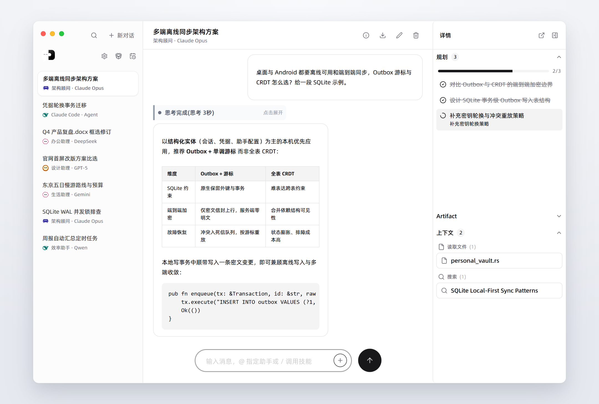
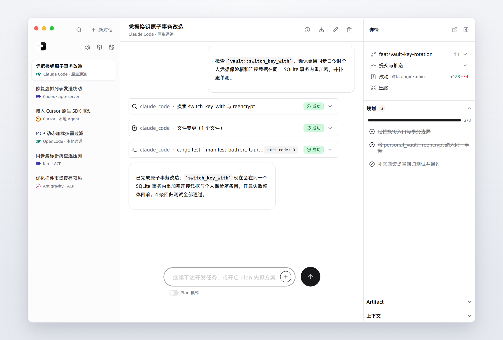
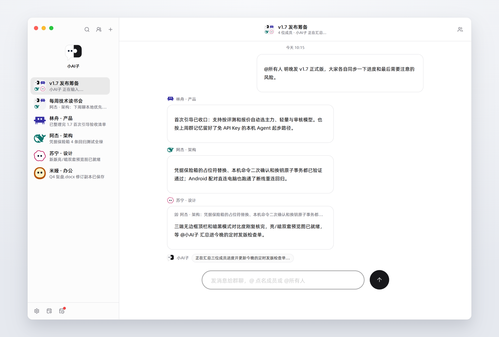
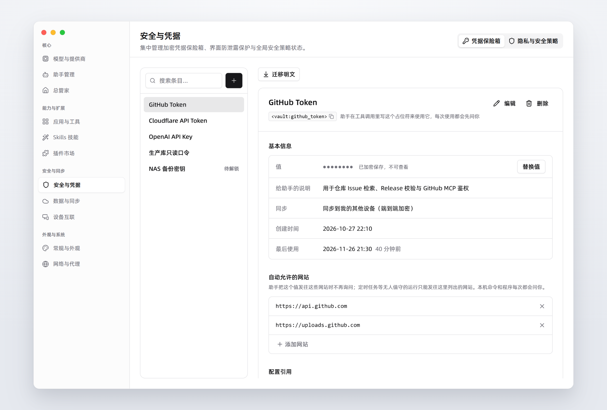
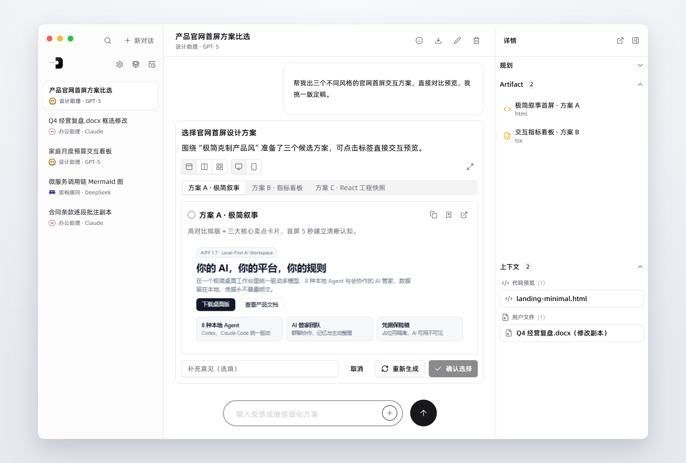
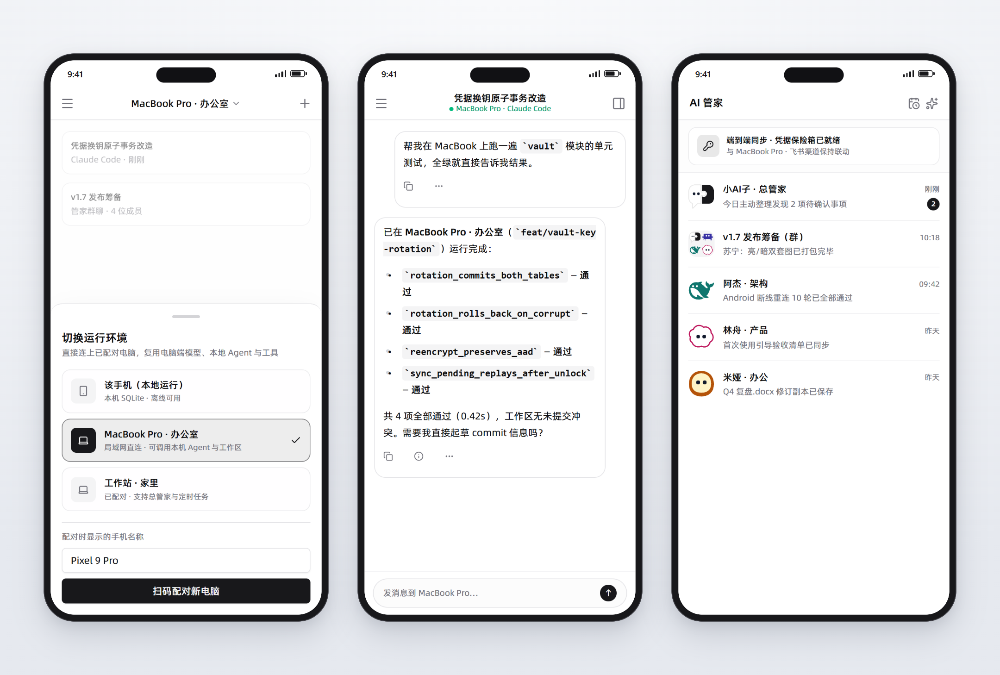

<div align="center">

<br/>


# AIPP

**Your AI. Your Platform. Your Rules.**

A local-first, cross-platform AI workspace unifying multi-model chat, native local Agents, a collaborative AI Butler team, and a zero-plaintext Credential Vault.

<br/>

[](https://github.com/xieisabug/AIPP/releases/latest)
[](LICENSE)
[](https://github.com/xieisabug/AIPP/releases/latest)

<br/>

[**Download**](https://github.com/xieisabug/AIPP/releases/latest) &nbsp;·&nbsp; [**Documentation**](docs/product/README.md) &nbsp;·&nbsp; [**Architecture**](docs/architecture.md) &nbsp;·&nbsp; [**简体中文**](README.md)

<br/>

<picture>
  <source media="(prefers-color-scheme: dark)" srcset="docs/readme/hero-dark.png" />
  <source media="(prefers-color-scheme: light)" srcset="docs/readme/hero-light.png" />
  
</picture>

</div>

<br/>

## One Workspace for Every Model & Local Agent

Stop jumping between browser tabs, terminals, and isolated clients. AIPP brings cloud LLMs, local models, and coding agents together under one consistent interface.

- **Multi-Model Freedom**: Switch effortlessly across OpenAI, Anthropic, DeepSeek, Gemini, Ollama, GitHub Copilot, OpenCode Go, and Magpie—with message branching, regeneration, reasoning traces, and context compaction (`/compact`).
- **Unified Native Agent Drivers**: Run **Codex, Claude Code, Cursor, OpenCode, Pi, Kiro, Antigravity**, and **ACP** agents natively with unified activity timelines, inline code diffs, and terminal output.
- **Built for Real Engineering Workflows**: Includes **Plan Mode**, native permission tiers, per-session **Git workspace** controls (branch switching, diff stats, AI-drafted commits), and detailed token, cache, and subscription quota tracking.

<picture>
  <source media="(prefers-color-scheme: dark)" srcset="docs/readme/agent-dark.png" />
  <source media="(prefers-color-scheme: light)" srcset="docs/readme/agent-light.png" />
  
</picture>

<br/>

## An AI Butler Team That Collaborates, Remembers & Acts

Every assistant acts as a persistent contact—ready for direct conversations, multi-assistant group discussions, and background delegation.

- **Private Chats, Group Chats & Handoffs**: Mention `@member` or `@all` in group chats, or let the routing model pick the right responders automatically; supports multi-round discussions, live progress updates, and cross-assistant delegation.
- **Scoped Long-Term Memory**: Automatically distills context into Assistant-private, Group-shared, or Global memories and replays only incremental deltas across turns.
- **Proactive Care & Scheduled Tasks**: Autonomous background runs review open threads and surface actionable proposal cards; scheduled tasks run unattended with safety gates and Butler escalation, notifying you only when it matters.

<picture>
  <source media="(prefers-color-scheme: dark)" srcset="docs/readme/butler-dark.png" />
  <source media="(prefers-color-scheme: light)" srcset="docs/readme/butler-light.png" />
  
</picture>

<br/>

## Let AI Use Secrets Without Ever Seeing Them

Security enforced by architecture, not prompt instructions. AIPP isolates sensitive credentials at the Rust execution layer.

- **Personal Credential Vault**: Secrets stay encrypted via your OS keychain. Assistants only pass `<vault:key>` placeholders in tool arguments; the runtime injects real values at dispatch and redacts outputs—keeping plaintext out of model context, logs, and chat history.
- **Approval & Site Allowlists**: Approve each use via inline confirmation cards; restrict reusable approvals to explicit web origins while always prompting for local shell or file access. MCP servers and model providers can safely reference vault entries too.
- **Local-First with Optional Sync**: All data is stored in local SQLite by default, with zero telemetry. AIPP includes a privacy masking mode and optional self-hosted sync ([`sync-server/`](sync-server)). Vault credential values that you choose to sync are end-to-end encrypted once you set a sync passphrase.

<picture>
  <source media="(prefers-color-scheme: dark)" srcset="docs/readme/vault-dark.png" />
  <source media="(prefers-color-scheme: light)" srcset="docs/readme/vault-light.png" />
  
</picture>

<br/>

## Preview, Compare & Deliver Directly in Chat

Go from idea to runnable artifact or revised document without breaking your flow.

- **In-Chat Solution Comparison**: Generate multiple interactive candidates or full project snapshots side by side, switch tabs to inspect, iterate with feedback, and build snapshots in isolated Bun sandboxes.
- **Live Artifacts & Script Execution**: Preview HTML, React, Vue, Mermaid, and Draw.io live in-app or in standalone windows, and execute Python or Shell scripts directly.
- **Non-Destructive Office Editing**: Preview Office files, highlight multiple selections with feedback for AI revision, and always save edits to a new copy—never silently overwriting your original file.

<picture>
  <source media="(prefers-color-scheme: dark)" srcset="docs/readme/delivery-dark.png" />
  <source media="(prefers-color-scheme: light)" srcset="docs/readme/delivery-light.png" />
  
</picture>

<br/>

## Everywhere You Work—With Desktop Power in Your Pocket

Consistent native experience across desktop and mobile, seamlessly bridged over your local network.

- **Unified Cross-Platform Desktop**: Frameless modern title bars across Windows, macOS, and Linux, paired with a global `Ctrl+Shift+I` quick-ask popup and system tray presence.
- **Android Standalone + Paired Desktop Bridge**: Use Android offline on its own, or pair via QR code over LAN to switch environments and drive your desktop's local Agents, workspaces, and Butler chats directly from your phone.
- **External Channels (Experimental)**: Bidirectional Feishu/Lark integration bringing Butler conversations, proactive digests, and interactive cards into team messaging.

<picture>
  <source media="(prefers-color-scheme: dark)" srcset="docs/readme/everywhere-dark.png" />
  <source media="(prefers-color-scheme: light)" srcset="docs/readme/everywhere-light.png" />
  
</picture>

<br/>

## Ecosystem & More

- **App Catalog & Dynamic MCP**: Built-in web search/fetch, file operations, and shell tools alongside an App Catalog for OAuth and local MCP servers—dynamically loaded on demand with model-assisted safety review.
- **GitHub Capability Bundles**: Install version-pinned GitHub Agent bundles that package Skills and MCP servers together, with clean updates and rollbacks.
- **Plugin Marketplace & Custom Avatars**: Extend AIPP with themes, custom Markdown renderers, `!bang` shortcuts, request hooks, background services, and declarative avatar/accessory packs.
- **Skills System**: Install local or official skills, bind them per assistant, and invoke them inline with `/`.
- **Everyday Polish**: `!bang` commands, one-click export to Markdown / PNG / PDF / DOCX, global search, and token usage analytics.

<br/>

## Quick Start

Download the latest installer from [GitHub Releases](https://github.com/xieisabug/AIPP/releases/latest):

| Windows | macOS | Linux | Android |
| :---: | :---: | :---: | :---: |
| `.msi` | `.dmg` (Apple Silicon / Intel) | `.AppImage` | `.apk` (arm64) |

1. **Install & Launch**: Desktop launches directly into the guided **First-Run Onboarding**.
2. **Auto-Configure**: Automatically detects installed local Agents or recommends Primary, Fast, and Review models by benchmark and pricing once you add a provider.
3. **Start Working**: Press `Ctrl+Shift+O` for the main workspace, `Ctrl+Shift+I` for quick ask anywhere, or open the Butler window to coordinate your assistant team.

<br/>

<details>
<summary><strong>Build from Source, Self-Hosted Sync & Tech Stack</strong></summary>

<br/>

### Prerequisites

Node.js 20.19+ / 22.12+, pnpm 10, Rust stable, `protoc`, and [Tauri 2 prerequisites](https://tauri.app/start/prerequisites/).

```bash
git clone https://github.com/xieisabug/AIPP.git
cd AIPP
pnpm install

pnpm tauri dev                                   # Desktop dev mode
pnpm package                                     # Build desktop installer
pnpm test                                        # Frontend tests
cargo test --manifest-path src-tauri/Cargo.toml  # Backend tests
```

- **Dependencies**: Cargo automatically fetches the pinned `rust-genai` fork; no sibling checkout required.
- **Android**: Requires Android SDK / NDK and JDK 17—see [`scripts/android-dev.ps1`](scripts/android-dev.ps1).
- **Self-Hosted Sync**: Optionally run [`sync-server/`](sync-server) (FastAPI + SQLite). The server stores ordinary synced records such as chat messages, which are not end-to-end encrypted. Once a sync passphrase is set, the server receives synced Vault credential values as ciphertext.
- **Contributing**: Please read [AGENTS.md](AGENTS.md) and [Architecture Overview](docs/architecture.md) before making changes.

| Layer | Stack |
| :--- | :--- |
| Desktop & Backend | Rust · Tauri 2 · SQLite (rusqlite) · Tokio |
| Frontend & UI | React 19 · TypeScript · Vite · shadcn/ui · Tailwind CSS v4 |
| AI & Protocols | genai fork · rmcp (MCP) · Native Agent Drivers (Codex / Claude Code / Cursor / OpenCode / Pi / Kiro / Antigravity / ACP) |
| Sync & Web | FastAPI ([`sync-server/`](sync-server)) · chromiumoxide |

</details>

<br/>

## Documentation

[Product Docs](docs/product/README.md) · [First-Run Onboarding](docs/product/23-首次使用引导.md) · [Agents & ACP](docs/product/11-ACP集成.md) · [Butler System](docs/product/18-Butler任务系统.md) · [Credential Vault](docs/product/22-凭据保险箱.md) · [Scheduled Tasks](docs/product/09-定时任务.md) · [Apps & MCP](docs/product/04-MCP工具系统.md) · [GitHub Bundles](docs/product/21-GitHub插件包.md) · [Plugins](docs/product/10-插件系统.md) · [Artifacts](docs/product/06-制品预览与执行.md) · [Storage & Sync](docs/product/15-数据存储.md)

---

<div align="center">

Open-sourced under [Apache 2.0](LICENSE) · Built with Rust, React & AI

</div>
