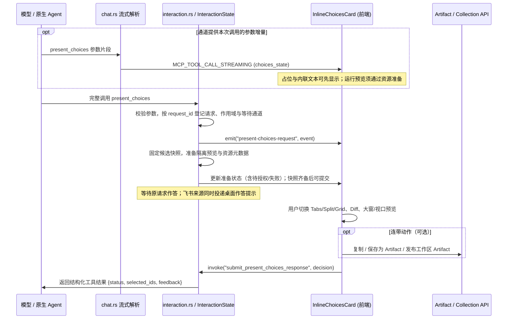

# 多版本富内容对比与选择能力（`present_choices`）实施计划

> 关联需求：LeaderAI **#77**
>
> 定位：在内置工具集 `aipp:ui_interaction` 下新增 `present_choices`。模型一次提交候选，AIPP 托管对比、选择与交付，返回结构化决策。有参数增量的通道支持内联候选渐进展示。

---

## 1. LeaderAI #77 更新后的需求描述与验收条件

> 以下内容可直接同步回 LeaderAI **#77** 的需求描述与验收条件字段。

### 需求描述

在对话与管家场景中，经常需要 AI 一次性产出多个候选版本供用户对比决策——例如多版本的小说段落/文案/大纲，或多版本的 UI 设计稿（单文件 HTML/CSS/JS、图片、或 React/Vue Artifact 原型）。

现有能力各自存在明显边界：`ask_user_question` 仅支持短文本选项；`preview_file` 是只读非阻塞预览且模型在创作比选场景下不易主动触发；`preview_code` 要求模型手写对比切换与提交脚本，在长文案与多套隔离 UI 场景下极易样式冲突或脚本出错；`Artifact` 定位是持久交付物，不适合承载未选中的过程草稿。

本需求在 `aipp:ui_interaction` 下新增独立工具 **`present_choices`**，把**内容生产（AI）**与**对比/选择交互壳（AIPP 宿主）**解耦，一期完整实现以下能力：

1. **候选格式与来源**：`markdown`、`text`、`html`、`image` 可内联或引用文件；`artifact` 用 `artifact_key + entry_file` 指向当前会话工作区中的完整工程，包含入口引用的组件、样式和静态资源。
2. **内联内容渐进展示**：收到本次调用的参数增量后，按 `expected_count` / `candidate_titles` 生成占位，可即时阅读已输出的内联文本。文件和工程在完整调用到达后准备预览。模型仍只调用一次 `present_choices`。
3. **宿主托管的对比与决策交互**：
   - 支持 `tabs` / `split`（双栏并排）/ `grid`（卡片网格）视图切换；
   - `html` / `artifact` 候选支持全屏/大窗对比与桌面/手机视口宽度切换；
   - `markdown` / `text` 候选支持任意两个版本的文本 Diff 高亮对比；
   - 支持单选/多选、可选微调意见、“都不满意 / 重新生成”与取消，并把结构化决策回传给模型继续下一步。
4. **选后连带动作**：支持对候选（尤其是已选定版本）一键复制内容、一键保存为 Artifact 收藏（或将工作区 `artifact` 候选正式发布到侧边栏）、独立预览窗口打开。
5. **全场景一致性**：普通聊天与管家复用 `ask_user_question` 的等待、停止与恢复行为；移动端保留应用内选择。飞书展示摘要，引导用户到 AIPP 桌面端原会话作答。定时任务沿用无人值守门控。

### 验收条件（AC）

- [ ] **AC-1 工具注册与模型调用**：`aipp:ui_interaction` 包含默认免工具审核的 `present_choices`。五种候选的来源按 §4.1 校验；工具免审不改变外部资源审批和工程运行权限。
- [ ] **AC-2 内联候选的流式呈现与占位**：本项按通道和来源验收。能提供工具参数增量时，从本次调用的第一个可解析字段开始渐进展示；只交付完整参数的通道（含此类原生 Agent）直接进入准备态。文件与工程的内容预览从完整调用到达后开始，写文件期间的进度不属于此项。
  - 当模型先输出 `expected_count` 或 `candidate_titles` 时，卡片立即渲染对应数量的标签/卡片位：已完成项可立即浏览，当前生成项展示实时进度/局部文本，未开始项展示标题（如有）与 Loading 骨架屏；
  - 未提供总数时，流结束前显示一个动态占位；完成、失败或中断时清除占位。混合来源的卡片可以提前展示引用项的标题，但其内容要等快照就绪。
- [ ] **AC-3 多版本隔离与对比体验**：
  - 每个 HTML / 工程候选隔离运行。对象闭合仅表示参数已接收。执行脚本或加载图片、字体等资源前须完成该版本的资源准备；未获许可的外部请求始终被拦截。此约束也覆盖流式 Markdown、独立预览窗口与历史重开。
  - 支持在 `tabs` / `split` / `grid` 间切换；
  - `html` / `artifact` 支持一键展开大窗对比与桌面/移动端视口切换；
  - `markdown` / `text` 支持选定任意两版开启文本 Diff。桌面完整工程预览须通过多文件 React 和 Vue 样例，至少覆盖相对导入的子组件、CSS 和本地图片；预览、独立窗口与发布后的侧边栏均使用同一版工程。
- [ ] **AC-4 完整决策闭环与回传**：
  - 支持 `single`（单选）与 `multiple`（多选）；
  - 选定或要求重做时，若开启 `allow_feedback` 可附意见；重做返回 `status: "rejected"`，取消返回 `status: "cancelled"`。
  - 活动请求按 `request_id` 等待应用内操作；选定或要求重做后把决策交回原调用。主动取消返回 `cancelled`。停止执行则中止原调用并清理等待。服务端校验状态、候选 ID 和选择数量；重复提交至多产生一次决策和一次续接。
- [ ] **AC-5 选后连带动作与历史收敛态**：
  - 支持一键复制候选内容/源码；
  - 支持的单文件内容可用 `save_artifact_to_collection` 收藏；工作区候选从选定的完整工程快照发布至侧边栏，之后可独立打开。
  - 进入待选择态前固定全部候选版本。选定后卡片收敛为已选版本与反馈，仍可展开回顾、复制或保存当时的内容。修改或删除源文件及工程子文件后重新打开，历史与选后交付仍使用原快照。
- [ ] **AC-6 管家模式、持久化恢复与边界保护**：
  - 刷新或切换会话可重绑仍在运行的同一请求。进程重启后已完成卡片还原历史；普通聊天的未完成调用显示已中断并释放队列，管家有效待答记录按 `ask_user_question` 的条件恢复。取消恢复卡不触发续接。
  - 管家简洁聊天中正常展示实时与历史卡片（含原生 Agent 通道经 `butler_interaction_event` 持久化的记录）；
  - 定时任务无人值守（`scheduled_run`）调用 `present_choices` 时由 `scheduler/gate.rs` 直接拒绝并说明原因，不挂起卡死；
  - 移动端可单栏浏览并在应用内选择；完整工程遵循移动预览能力边界。飞书在请求等待期间即投递编号文本或富内容摘要，附原会话标识及“请到 AIPP 桌面端的本次会话中选择”；飞书消息回复和卡片回调均不提交选择。

---

## 2. 架构设计总览

### 2.1 在 `aipp:ui_interaction` 中的定位

| 工具 | 定位 | 是否阻塞 | 典型场景 |
|---|---|---|---|
| `ask_user_question` | 轻量表单/短选项提问 | 是 | 澄清偏好、参数确认 |
| `preview_file` | 只读多文件预览 | 否 | 展示文档、图片、PDF、Office |
| `preview_code` | 单块渐进式交互小组件 | 可选 | 模拟器、计算器、定制交互面板 |
| **`present_choices`** | **多版本富内容对比与宿主托管选择** | **是** | **多版小说段落/文案比选、多版 UI 原型/设计稿/生图选型** |

### 2.2 端到端数据流



---

## 3. 协议与数据结构设计

### 3.1 工具 Input Schema（`aipp:ui_interaction::present_choices`）

**流式字段顺序**：建议模型先输出轻量字段，再输出 `candidates`。解析器接受任意合法字段顺序。`expected_count` 和 `candidate_titles` 仅作生成提示，最多显示 6 个槽位；最终布局和可选择的 ID 以通过校验的完整数组为准。

```json
{
  "type": "object",
  "properties": {
    "title": {
      "type": "string",
      "description": "Comparison card title, e.g. '选择第三章开篇风格' or '选择登录页 UI 方案'."
    },
    "prompt": {
      "type": "string",
      "description": "Optional brief guidance shown above the candidates."
    },
    "expected_count": {
      "type": "integer",
      "minimum": 2,
      "maximum": 6,
      "description": "Emit BEFORE `candidates`. Total number of candidates you are about to generate (2-6), so the UI can show placeholder loading slots immediately."
    },
    "candidate_titles": {
      "type": "array",
      "minItems": 2,
      "maxItems": 6,
      "items": { "type": "string" },
      "description": "Optional. Emit BEFORE `candidates`. Ordered short titles for each planned candidate so loading placeholders display meaningful labels before content arrives."
    },
    "selection_mode": {
      "type": "string",
      "enum": ["single", "multiple"],
      "default": "single"
    },
    "layout": {
      "type": "string",
      "enum": ["tabs", "split", "grid"],
      "default": "tabs",
      "description": "Initial layout: 'tabs' for long text/full pages, 'split' for side-by-side comparison, 'grid' for compact cards/images."
    },
    "allow_feedback": {
      "type": "boolean",
      "default": true,
      "description": "Allow user to attach an optional refinement note when confirming or rejecting."
    },
    "candidates": {
      "type": "array",
      "minItems": 2,
      "maxItems": 6,
      "items": {
        "type": "object",
        "properties": {
          "id": { "type": "string", "description": "Unique stable identifier, e.g. 'v1', 'minimal_dark'." },
          "title": { "type": "string", "description": "Short display title of this version." },
          "summary": { "type": "string", "description": "Optional one-line highlight/style note." },
          "type": {
            "type": "string",
            "enum": ["markdown", "text", "html", "image", "artifact"],
            "description": "Renderer format. Use html for a self-contained page; use artifact for a workspace project with its entry and companion files."
          },
          "content": {
            "type": "string",
            "description": "Inline content (markdown/text/html or base64/data URL image)."
          },
          "url": {
            "type": "string",
            "description": "Local absolute file path (preferred for large HTML/text/images written via write_file) or URL."
          },
          "language": {
            "type": "string",
            "description": "Optional code language when type='text' or artifact hint."
          },
          "artifact_key": {
            "type": "string",
            "description": "Required when type='artifact'. Relative artifact key under current conversation artifact workspace."
          },
          "entry_file": {
            "type": "string",
            "description": "Required for artifact. Entry path relative to the project root identified by artifact_key; keep sibling modules, styles, assets and project configuration in that root."
          }
        },
        "required": ["id", "title", "type"],
        "additionalProperties": false
      }
    },
    "metadata": {
      "type": "object",
      "properties": {
        "origin": { "type": "string" }
      },
      "additionalProperties": false
    }
  },
  "required": ["title", "candidates"],
  "additionalProperties": false
}
```

### 3.2 工具返回结果（Tool Result JSON）

后端从当前请求的候选快照解析 ID 和标题。`selected` 在单选时恰有一个 ID，多选时至少一个，所有 ID 唯一且属于本次请求；`rejected` / `cancelled` 的 ID 列表为空。补充意见遵循 `allow_feedback`；关闭意见输入时也可要求重做。实时和恢复入口共用这套校验。

```json
// 1. 用户选定（单选或多选）
{
  "status": "selected",
  "request_id": "uuid",
  "selected_ids": ["v2"],
  "selected_titles": ["版本 B · 冲突前置"],
  "feedback": "喜欢版本 B 的节奏，但希望把第二句对话改得更克制"
}

// 2. 用户都不满意，要求重做
{
  "status": "rejected",
  "request_id": "uuid",
  "selected_ids": [],
  "feedback": "三个方案都偏保守，请给更有实验感的排版"
}

// 3. 用户取消
{
  "status": "cancelled",
  "request_id": "uuid",
  "selected_ids": []
}
```

### 3.3 流式增量状态结构（`PresentChoicesStreamingState`）

在 `src-tauri/src/api/ai/chat.rs` 中与 `PreviewCodeStreamingState` 并列提取，写入 `<!-- MCP_TOOL_CALL_STREAMING:... -->` 的 `choices_state` 字段：

```ts
export interface PresentChoiceStreamingCandidate {
    index: number;
    id?: string;
    title?: string;
    summary?: string;
    type?: "markdown" | "text" | "html" | "image" | "artifact";
    content?: string;
    url?: string;
    language?: string;
    artifact_key?: string;
    entry_file?: string;
    /** complete 仅指参数对象已闭合；资源准备和授权状态单独维护。 */
    stage: "complete" | "streaming" | "pending";
}

export interface PresentChoicesStreamingState {
    title: string;
    prompt?: string;
    expectedCount?: number;
    candidateTitles: string[];
    selectionMode: "single" | "multiple";
    layout: "tabs" | "split" | "grid";
    allowFeedback: boolean;
    candidates: PresentChoiceStreamingCandidate[];
    /** 当未拿到 expectedCount 且流未结束时，前端额外追加 1 个动态 loading 占位 */
    hasUnknownRemaining: boolean;
}
```

**流式解析器实现要点（状态机而非脆弱正则）**：
- 新增轻量字符级 JSON 扫描器（Rust 端 `extract_present_choices_streaming_state` + 前端兜底解析器共用同规则）：
  1. 提取顶层 `title`、`prompt`、`expected_count`、`candidate_titles`、`selection_mode`、`layout`、`allow_feedback`。
  2. 定位 `"candidates": [` 后的数组元素：跟踪大括号深度与字符串转义状态：
     - 每个已闭合 `{ ... }` 直接 `serde_json::from_str` 得到 `stage: "complete"`；
     - 最后一个未闭合 `{ ...` 提取已出现的 `id` / `title` / `summary` / `type` / 部分 `content` 得到 `stage: "streaming"`。
  3. 占位槽合成规则：
      - 收到有效的 `expected_count` 或标题列表时，根据计划数、标题数和已解析数补齐槽位，上限 6；流结束后按有效候选数收敛。
     - 若两者皆未到达，则保留当前 `parsed`，置 `hasUnknownRemaining = true`，由前端在末尾展示一个“正在构思下一个版本…”动态占位槽；流式结束时清空该占位。

---

## 4. 后端详细设计（Rust / `src-tauri`）

### 4.1 核心交互与状态管理：`src-tauri/src/mcp/builtin_mcp/interaction.rs`

1. **新增结构与校验**：
   - `PresentChoiceCandidate`、`PresentChoicesRequest`、`PresentChoicesRequestEvent`、`PresentChoicesDecisionPayload`、`PresentChoicesResponse`。
   - `PresentChoicesRequest::validate()`：
     - `candidates.len()` 在 `2..=6` 之间；
     - 每个 `id` 非空且唯一，`title` 非空；
     - `type` 限定 `"markdown" | "text" | "html" | "image" | "artifact"`；
      - `artifact` 仅接受成对的 `artifact_key` 与 `entry_file`；其他类型在 `content` 和 `url` 中恰选一个。`url` 中的本地绝对路径与 HTTP(S) 来源分开处理；后者适用外部资源策略，获取许可前不读取内容。
2. **内容准备管线（高复用）**：
    - 内联文本和图片固定原始内容；本地文件一次读取并固定字节、格式和摘要。沿用现有文本解码与文件 relay，relay 面向快照签发短期地址。远端 URL 的候选主体遵循资源许可后固定其内容；未获准时显示待授权，允许取消。页面引用的外部资源单独按预览策略处理。
    - 为请求保留 `conversation_id + request_id + candidate_id` 对应的不可变快照引用。历史记录只引用持久内容和入口，不持久化 relay 地址。全部候选主体准备成功后再允许提交；准备失败说明候选与原因，清理未提交的临时数据。会话历史与已发布工程分别持有快照，按引用释放。
    - HTML、Markdown、图片及工程预览都经 `PreviewResourceState` 和宿主资源策略。增量内容先走纯文本/源码或禁用外部加载的渲染。对已闭合的内联候选可提前按内容摘要准备预览，确认与最终快照一致后复用；任何未准备好的版本保持可读状态。隔离 iframe 在授权前持续拦截外部请求，包括运行时生成的请求。
    - `artifact_key` 指定工程根，`entry_file` 指定入口。遍历并固定工程文件树，保留目录结构、依赖声明、锁文件、构建配置和静态资源；校验入口及每个收录文件解析后的路径均在该工程内，限制文件数与总大小，排除依赖缓存、版本控制目录及临时产物。快照使用临时目录完整写入后再发布引用，比较阶段不登记侧边栏 manifest。
    - 桌面工程预览从快照的独立工作副本解析相对导入，按工程配置构建并托管产物。现有 React/Vue 管理器仅接收入口源码，需扩展工程根目录入口。宿主在工程隔离环境内处理依赖与构建脚本；页面外链许可仅用于预览页面，本机执行与构建联网仍遵循各自的权限边界。启动、依赖或构建失败显示具体环节。按快照复用预览会话，最后一个视图关闭后回收进程。Android 沿用受限预览，对超出运行能力的工程展示快照文件与源码。
3. **挂起、作用域与清理**：
   - 在 `InteractionState` 中新增 `pending_present_choices: Arc<Mutex<HashMap<String, PendingPresentChoicesRequest>>>`（带 `AgentRequestScope` 与 `registered_at`）。
   - `PendingInteractionCleanup` 增加 `InteractionCleanupKind::PresentChoices`。
   - `cancel_requests_for_scope` 同时取消 `pending_present_choices`，保证停止对话/打断管家任务时不会残留悬挂的 `oneshot`。
4. **活动请求、原生 Agent 与重启恢复**：
    - 以 `ask_user_question` 为行为基准。把 `request_id`、执行会话、原始消息、可用的 `call_id` 和快照引用关联起来。刷新/切换后按执行会话列出内存中的请求，绑定原 ID；正常作答只完成该请求的等待通道。桌面飞书来源请求同样可见、可答。
    - 普通聊天用 `mcp_tool_call` 还原历史并关联快照。进程重启时结束已中断且无恢复记录的旧调用，显示具体原因并释放队列。
    - 管家按现有问答规则登记可恢复请求，保留原回合、目标修订与有效期；按 `kind` 区分问卷和选择，避免旧问卷读取端把选择当作 `questions`。缺少普通工具记录的原生交互沿用管家时间线归属，群成员请求绑定成员执行会话。
    - 管家重启后重新校验 waiting 状态、原目标、快照完整性与问答的 24 小时有效期。会话仍运行时提示稍后处理；其他工具结果不明时阻止恢复续接。允许恢复时结束与本请求绑定的旧调用并记录中断原因。快照不完整、过期、已停止或目标已变更时展示失效原因并收尾旧调用。
    - 恢复作答时，决策历史、请求状态以及 `selected` / `rejected` 对应的续接消息在同一事务中提交。恢复的答案作为新消息交回原会话，取消仅结束请求。沿用现有队列派发和 `butler_interactions_changed`；重复点击或双窗口提交只接受一次。
5. **新增 Tauri Commands**（并在 `src-tauri/src/lib.rs` 注册）：
   - `submit_present_choices_response(request_id, status, selected_ids, feedback)`
   - `list_present_choices_requests_for_conversation(conversation_id)`
    - `prepare_present_choices_request_for_ui(conversation_id, request_id)`：从已登记的快照准备历史或活动卡的预览，重新签发本地 relay，并应用当前资源授权。
    - `preview_choice_artifact_candidate(conversation_id, request_id, candidate_id)`：校验归属，从对应版本的工程快照启动或复用预览，供卡内和独立窗口使用。
    - `publish_choice_as_artifact(conversation_id, request_id, candidate_id)`：单文件类型把快照内容交给收藏 API；完整工程从快照物化到独立发布目录，复用 `show_artifact` 登记该目录。侧边栏重开使用工程预览入口。发布不覆盖已修改的草稿，同一候选重复操作可识别已发布版本。

### 4.2 工具注册、调度与安全边界

| 文件 | 改动内容 |
|---|---|
| [templates.rs](file:///E:/workspace/rust/aipp/src-tauri/src/mcp/builtin_mcp/templates.rs) | 在 `Some("ui_interaction")` 中注册 `present_choices`；免自动确认匹配列表加入 `"present_choices"`；更新模板单元测试 |
| [builtin_mcp/mod.rs](file:///E:/workspace/rust/aipp/src-tauri/src/mcp/builtin_mcp/mod.rs) | `ui_interaction` 分支派发 `present_choices`；在 `vault/placeholder.rs::expandable_arguments` 显式将选择工具列入不展开占位符的展示工具。 |
| [detection.rs](file:///E:/workspace/rust/aipp/src-tauri/src/mcp/detection.rs) | 用户交互类工具白名单加入 `"present_choices"` |
| [tool_review.rs](file:///E:/workspace/rust/aipp/src-tauri/src/mcp/tool_review.rs) | `Some("aipp:ui_interaction")` 免审核集合加入 `"present_choices"` |
| [butler_tools.rs](file:///E:/workspace/rust/aipp/src-tauri/src/mcp/butler_tools.rs) | 与 `ask_user_question` 保持一致的注入与无人值守过滤策略（注意第 25 行与第 192 行） |
| [scheduler/gate.rs](file:///E:/workspace/rust/aipp/src-tauri/src/scheduler/gate.rs) | `human_only_reason` 对 `("aipp:ui_interaction", "ask_user_question" \| "present_choices")` 直接拒绝，避免定时任务挂起 |
| [api/ai/chat.rs](file:///E:/workspace/rust/aipp/src-tauri/src/api/ai/chat.rs) | `build_streaming_tool_call_display` 中识别 `ui_interaction::present_choices`，提取 `choices_state` 注入流式标记 |
| `external_channels/presentation.rs`、`feishu/interaction.rs` 与交互发起入口 | 等待期间向飞书投递文本候选编号、富内容摘要和桌面作答指引。沿用来源会话映射；桌面卡片是飞书来源请求的作答入口，普通飞书回复不解析为选择。 |
| [api/mobile_capability.rs](file:///E:/workspace/rust/aipp/src-tauri/src/api/mobile_capability.rs) | `aipp:ui_interaction` 已放行，仅需确认 `present_choices` 不触发桌面专属拦截；React/Vue Bun 预览在移动端走源码/受限预览降级 |

---

## 5. 前端详细设计（React 19 + TypeScript）

### 5.1 新增与改造模块清单

| 文件路径 | 职责 |
|---|---|
| `src/utils/presentChoices.ts` | 类型定义、严格/宽松 JSON 解析器（含流式部分候选解析与占位生成）、工具结果解析、签名计算 |
| `src/utils/textDiff.ts` | 轻量纯 TS 文本 Diff 算法（LCS 行级 + 词级差异），零重型依赖，供 Markdown/文本版本对比使用 |
| `src/components/InlineChoicesCard.tsx` | 主组件：覆盖流式生成态、待选择交互态、已提交收敛摘要态、大窗全屏对比弹窗、Diff 视图、连带动作栏 |
| `src/components/ChoicesCandidateRenderer.tsx` | 显示已准备的 Markdown、文本、图片和隔离 HTML；工程从快照预览服务取得入口，复用适用的渲染器；支持视口切换、源码浏览和独立窗口。 |
| `src/services/builtinMcpToolComponents.tsx` | 注册 `builtin.present-choices`（匹配 `toolName: "present_choices"`，优先级 100） |
| `src/components/butler/ButlerPresentationContext.ts` | `interactionTools` 集合加入 `"present_choices"` |
| `src/components/butler/ButlerInteractionResult.tsx` | 增加 `props.toolName === "present_choices"` 渲染分支 |
| `src/components/butler/butlerTimeline.ts` & `butlerGroupResults.tsx` & `butlerInteractions.ts` | 支持 `kind === "choices"` 与执行中的 `present_choices` 卡片按发生时间投影 |
| `src/components/conversation/messageHeightEstimate.ts` & `useMessageListElements.tsx` | 为包含 `present_choices` 的消息预估合理高度，避免 Virtuoso 滚动抖动 |
| `src/components/chat-sidebar/types.ts` & `ContextList.tsx` & `useContextList.ts` | 可选在会话上下文栏索引 `present_choices` 记录，方便长对话快速回跳 |

### 5.2 `InlineChoicesCard` 交互与视觉状态设计

1. **流式生成态（`isStreaming === true`）**：
   - 顶部标题栏显示 `title` + 动态进度胶囊（已知总数显示 `已生成 1 / 3`，未知总数显示 `已生成 1 项 · 生成中…`）。
   - 标签栏 / 网格中：
      - `stage === "complete"`：可浏览已收齐的内联正文/源码。运行预览的就绪状态由宿主单独标记。
      - `stage === "streaming"`：显示实时文本或 HTML 源码片段；Markdown 使用禁用外部加载的渲染。引用项先显示标题和准备状态，完成调用后生成其快照与预览。
     - `stage === "pending"`（已知总数占位）或尾部动态占位（未知总数）：显示标题（如有）或“候选 N” + 骨架屏（Skeleton）+ `等待生成…` 文案。
    - 仅当完整请求已登记并绑定 `request_id`、候选快照均就绪时启用决策栏。网络来源待许可时仍可取消请求。

2. **待选择交互态（请求已绑定且快照就绪）**：
   - **顶部工具条**：
     - 视图切换：`标签页（Tabs）` / `并排（Split）` / `网格（Grid）`（移动端默认单栏 `Tabs`，隐藏并排）；
     - 类型专属快捷工具：
       - `markdown` / `text`：出现 **`对比差异（Diff）`** 开关（选择基准版本 vs 目标版本，显示增删高亮）；
       - `html` / `artifact`：出现 **视口切换（桌面 / 手机 390px）** 与 **`全屏对比`** 按钮（打开大尺寸 Dialog，支持两版并排大屏预览与直接拍板）。
      - 外部资源提示按钮沿用 `PreviewExternalResourcesDialog`。候选主体需要授权时在准备态即可打开。页面可选外部资源未获许可时保留拦截，不阻塞已有快照的选择。
   - **每个候选卡片头部**：
     - 版本标题 + `summary` 标签；
     - 单选模式为 Radio / 高亮选框，多选模式为 Checkbox；
     - 快捷连带动作图标：**复制内容**、**保存为 Artifact**（HTML/Markdown/SVG/React/Vue 弹出轻量保存或直接收藏并 toast 提示；`artifact` 类型额外提供 **发布到侧边栏** 与 **独立窗口打开**）。
   - **底部决策栏**：
      - 左侧：`都不满意，重新生成`（允许反馈时可填写原因，提交 `status: "rejected"`）与 `取消`；
     - 中间：单行可选输入框 `附带微调意见（选填，例如：选版本 B 但把主色改暖）`；
     - 右侧：主按钮 `确认选择（版本 B）` / `确认选择（已选 2 项）`。

3. **已完成收敛态（`status === "selected" | "rejected" | "cancelled"`）**：
   - 默认收敛为与 `AskUserQuestionCard` summary / `MessagePreviewToolCall` 视觉一致的紧凑卡片：
     - 头部：`已选择：版本 B · 冲突前置`（或 `已要求重新生成` / `已取消`）+ 选中版本的快速操作（**复制选中项**、**保存为 Artifact**）+ **`展开全部候选（3）`** 折叠按钮；
     - 若用户提交了 `feedback`，展示一行 `补充意见：...`；
     - 展开后可完整回看所有候选版本、重新切换 Diff/全屏，但底部提交按钮变为只读状态（除非是重启恢复的未决请求）。

4. **HTML 与 Artifact 候选隔离与渲染细节**：
    - `html` 候选：每版使用独立沙箱 iframe，只接收宿主已准备的快照与资源策略。未授权的外部加载由策略拦截；点击“加载外部资源”后仅放行已批准资源，历史和独立窗口遵守相同规则。
   - `artifact` 候选：
     - 若 `preview_type` 为 `html` / `markdown` / `svg` / `mermaid` / `drawio`，直接在卡片内对应渲染器呈现；
      - `react` / `vue`：桌面端从工程快照启动实时预览，同一版本的全屏与独立窗口共用预览会话；源码 Tab 可查看工程内各文件。移动端沿用受限运行时和源码浏览，应用内可正常作答。

---

## 6. 关键边界与防坑清单

1. **大体积工具参数 & JSON 转义**：
    - 长篇 HTML 或多文件工程可先写入文件，再通过引用一次提交。文件写入期间沿用原工具的进度展示；比选卡在收到引用后显示标题、准备状态与快照预览。
2. **多候选并发渲染性能**：
   - 历史消息里的 `InlineChoicesCard` 默认折叠（遵循 `isLastMessage` / `useIsLatestMessageTurn()` 约定），不预先挂载隐藏的 iframe；
   - Tabs 模式下仅挂载当前激活 Tab 的 iframe，避免一次挂载 6 个 WebView/iframe 卡顿滚动。
3. **停止/中断与重启恢复**：
   - 用户点击停止按钮时，`cancel_requests_for_scope` 立即向挂起的 `oneshot` 返回取消错误，工具调用状态正确结束；
    - 刷新重绑活动请求，进程重启按 §4.1 分别收尾普通聊天和恢复管家有效待答记录。停止、到期与重复作答都不能重新派发旧工作。
4. **凭据保险箱合规**：
    - 在 `vault/placeholder.rs::expandable_arguments` 中将 `present_choices` 与 `ask_user_question` 一并排除占位符替换。候选、标题与意见里的 `<vault:键>` 始终作为字面文本；前端事件、快照、历史、复制及发布均沿用原文。工具仍走统一 transport。
5. **非阻塞与滚动稳定性**：
   - `messageHeightEstimate.ts` 为 `present_choices` 预留高度；组件以 `callId` / `llmCallId` 稳定挂载，不在流式结束切持久化态时整卡闪断重挂载。

---

## 7. 实施步骤与任务拆解

1. **Step 1 · 后端协议、校验与状态机**
   - 在 `templates.rs`、`builtin_mcp/mod.rs`、`detection.rs`、`tool_review.rs`、`butler_tools.rs`、`scheduler/gate.rs` 接入 `present_choices` 定义与准入规则。
    - 在 `interaction.rs`、`preview_resources.rs`、`vault/placeholder.rs`、`artifacts/workspace.rs` 与预览管理器中接入候选快照、资源准备、保险箱字面文本与完整工程预览/发布；注册按请求和候选 ID 操作的命令。
2. **Step 2 · 后端流式增量解析**
   - 在 `api/ai/chat.rs` 实现 `extract_present_choices_streaming_state`（含 `expected_count` / `candidate_titles` 提前占位与未知总数兜底逻辑），接入 `build_streaming_tool_call_display`。
3. **Step 3 · 管家持久化与外部渠道适配**
    - 实现普通聊天中断收尾；在管家问答存储、恢复事务与交互投影中支持 `choices`，覆盖原生 Agent 与群成员执行会话。
    - 在飞书来源请求进入等待时投递摘要和桌面作答提示，核实桌面卡可见且提交后原请求结束。
4. **Step 4 · 前端解析、Diff 工具与核心卡片组件**
   - 实现 `src/utils/presentChoices.ts`、`src/utils/textDiff.ts`、`src/components/ChoicesCandidateRenderer.tsx`、`src/components/InlineChoicesCard.tsx`。
   - 完成流式逐个亮起 + 骨架屏占位、Tabs/Split/Grid 切换、全屏对比弹窗、桌面/手机视口切换、文本 Diff、单选/多选 + 补充意见 + 重做、连带动作（复制 / 保存为 Artifact / 发布工作区 Artifact / 独立窗口打开）及历史收敛态。
5. **Step 5 · 前端聊天流、管家时间线与滚动集成**
   - 注册 `builtinMcpToolComponents.tsx`，更新 `ButlerPresentationContext.ts`、`ButlerInteractionResult.tsx`、`butlerTimeline.ts`、`butlerGroupResults.tsx`、`messageHeightEstimate.ts`、`useMessageListElements.tsx`、`ContextList.tsx`。
6. **Step 6 · 自动化测试与文档同步**
    - Rust：覆盖参数和决策校验、流式乱序/转义与无增量通道、快照与审批、作用域停止、定时门控。验证保险箱占位符不展开。覆盖同会话两张卡、刷新重绑、普通聊天重启中断、管家有效/过期/目标变更/其他调用结果不明、双窗口重复提交与取消恢复卡。
    - 前端与端到端：分别验收内联与文件候选的显示时机、未授权 HTML/Markdown/工程零外部请求、Diff 与多视图、单选/多选/重做及历史收敛。以多文件 React/Vue 各一套验证组件导入、样式和图片，修改并删除原工程后分别从历史、独立窗口和发布后的侧边栏核对原版。飞书来源在等待中收到指引，在桌面作答一次；Android 在受限预览下仍可提交。
    - 构建与验证：`npm run build`、`cargo check --manifest-path src-tauri/Cargo.toml`，按受影响功能运行精确范围的 Rust 与前端测试。
    - 更新 [内置工具](./product/05-内置工具.md)、Artifact 工作区说明、[移动导航与预览](./product/20-移动导航与预览.md) 及飞书作答指引。

## 落地约定

完整工程使用本机 Bun。每次安装依赖与运行 `scripts.build` 前，通过应用内确认框展示命令、实际脚本和输出目录，两步属于同一次确认。构建脚本以当前用户权限运行，预览只加载产物快照。已构建的版本再次打开时复用产物，同时打开的视图共用该候选的 Bun 预览进程，最后一个视图关闭后退出。

流式卡片直接解析现有 `MCP_TOOL_CALL_STREAMING` 事件中的工具参数，选择状态由原会话和请求 ID 查询。工程快照、结果和恢复命令位于 `mcp/builtin_mcp/choices/`，卡片和隔离工程预览位于 `src/components/choices/`。
